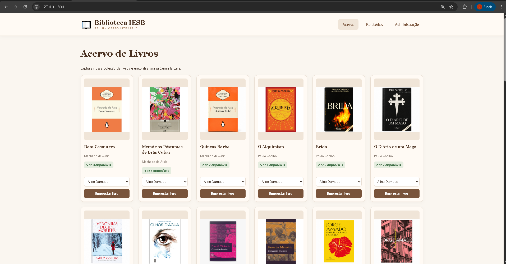
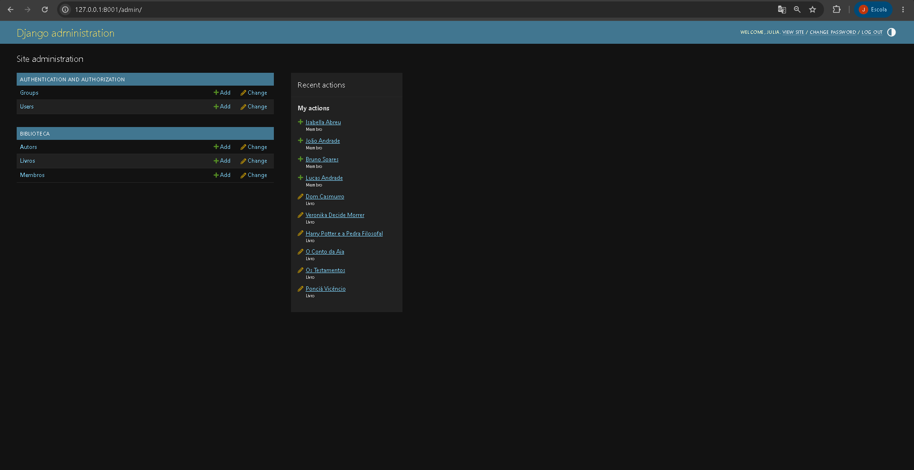
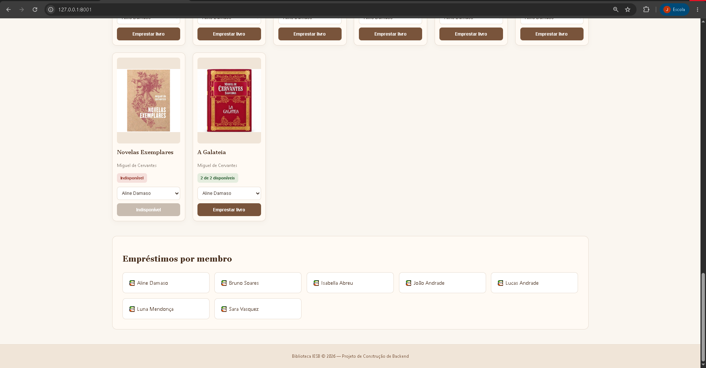
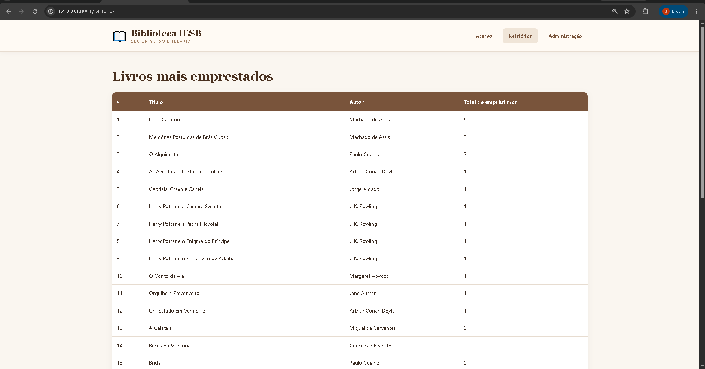

# Biblioteca IESB — Sistema Online

🌐 **Acesse a biblioteca funcionando:**

https://juliarms.pythonanywhere.com/

Projeto desenvolvido em Django para a disciplina Construção de Backend do IESB.

O site permite visualizar o acervo de livros, suas capas, a disponibilidade e o relatório dos livros mais emprestados.

---

# Sistema de Biblioteca — Projeto 2

Projeto desenvolvido para a disciplina Construção de Backend do IESB, utilizando Python e Django.

## Funcionalidades

- Cadastro de autores, livros e membros pelo Django Admin
- Catálogo de livros com capas e ordenação personalizada
- Empréstimos com prazo de 14 dias
- Controle de estoque e bloqueio de empréstimos indisponíveis
- Devolução com reposição de cópias
- Identificação de empréstimos atrasados
- Relatório dos livros mais emprestados com Django ORM

## Tecnologias

Python, Django, SQLite, HTML, CSS e Pillow.

## Como executar

1. Criar o ambiente virtual: `python -m venv venv`
2. Ativar no Windows: `venv\Scripts\activate`
3. Instalar as dependências: `pip install -r requirements.txt`
4. Criar o arquivo `.env` com a variável `DJANGO_SECRET_KEY` e uma chave secreta própria.
5. Aplicar as migrations: `python manage.py migrate`
6. Criar um administrador: `python manage.py createsuperuser`
7. Executar o servidor: `python manage.py runserver`

## Testes automatizados

Executar `python manage.py test`.

O projeto possui oito testes automatizados que verificam as regras de negócio.

## Capturas de tela

### Acervo de livros

### Administração

### Empréstimos

### Relatórios

As imagens do painel administrativo, acervo e empréstimos estão na pasta `prints/`.

## Autor

Projeto acadêmico — IESB — 2026.